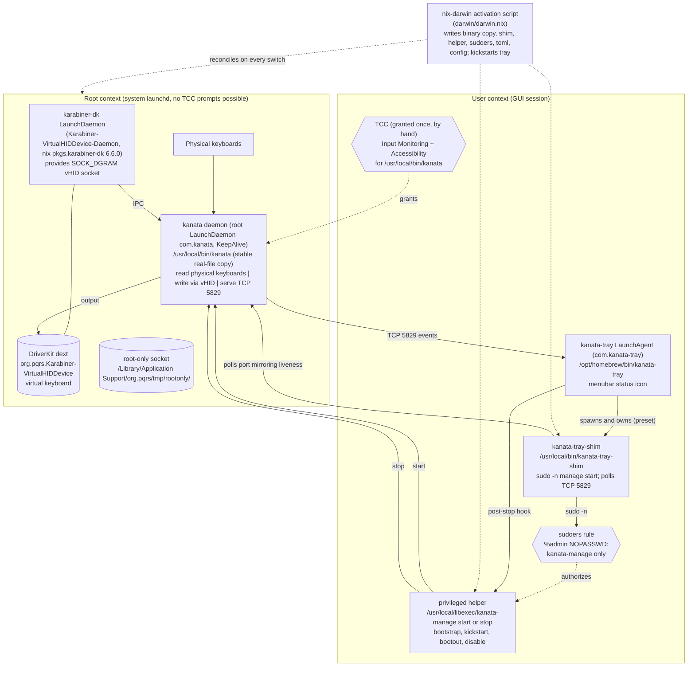

# ADR-0002: Kanata Root LaunchDaemon with Tray Lifecycle Twin

- **Status**: Accepted
- **Date**: 2026-09-19
- **Deciders**: Matthias (config owner), coding agent

## Context

Kanata (via [Karabiner-DriverKit-VirtualHIDDevice](https://github.com/pqrs-org/Karabiner-DriverKit-VirtualHIDDevice))
is the keyboard remapping layer of this machine (Neo2 via `basbousa.kbd`).
The previous setup had repeatedly broken after `nix flake update` +
`darwin-rebuild switch`, and its last mitigation ("hacking mode") embedded
state outside the flake: a wrapper script smuggled into the Homebrew
`kanata-tray` Cellar (`bin/kanata-tray.real` plus a hand-written wrapper) and a
sudoers rule pinned to a versioned Cellar path (`/opt/homebrew/Cellar/kanata-tray/0.8.0/…`).
Requirement: Kanata must work — including the tray icon for
pause/resume/status — after **every** nix update and switch, with no version-,
path- or session-dependent one-off state.

Three platform facts drove the design:

1. **TCC pins permissions to the real, resolved executable path.**
   `System Settings → Privacy & Security → Input Monitoring` grants are
   attributed to the *resolved* executable path, not to a symlink. Evidence:
   `tccd` logs `notifyUserOfDeniedAccessBy: for /nix/store/<new-hash>/bin/kanata`
   while the approved entry pointed at `/Applications/kanata`. The nix store
   hash changes on every rebuild that touches the package, so a store path —
   or a symlink to one — invalidates the grant every update.
2. **Root daemons cannot receive a TCC prompt.** `tccd` log:
   `notifyUserOfDeniedAccessBy … fails when requestor has UID 0`. A crash
   loop (`launchctl` `runs = 9918`, exit code 1) is invisible; the user cannot
   approve a daemon that never appears in the GUI.
3. **kanata itself requires root.** The latest
   [`docs/setup-macos.md`](https://github.com/jtroo/kanata/blob/main/docs/setup-macos.md)
   prescribes: kanata must run as root because the Karabiner virtual HID
   daemon exposes its IPC under
   `/Library/Application Support/org.pqrs/tmp/rootonly/` (mode `0700 root`),
   and it must read physical keyboards (TCC Input Monitoring) while writing
   through the DriverKit virtual device.

A fourth fact defined how the *tray* must be integrated: **kanata-tray
(rszyma/kanata-tray v0.8.0) is hardcoded to spawn and own the kanata process**
(`runner.Run → exec.CommandContext → cmd.Wait`). It has no "monitor an
external daemon" mode; its icon state is derived purely from the child
process lifecycle. Conversely, a kanata spawned by the tray (user context)
cannot open the root-only vHID socket — the core conflict.

## Decision

Split the process into three cooperating parts, all reconciled by
`darwin/darwin.nix` on every activation:

1. **Root LaunchDaemon `com.kanata`** (`launchd.daemons.kanata`) — the real
   kanata remapping process, using a stable binary copy and delegated to the
   privileged helper for lifecycle control (see below). TCC permissions
   (Input Monitoring + Accessibility) are granted **once** to
   `/usr/local/bin/kanata`.
2. **Stable real-file copy at `/usr/local/bin/kanata`** (activation script;
   absolute rule: *copy, never symlink* — TCC resolves symlinks). The copy is
   refreshed on every switch from `${pkgs.kanata-with-cmd}`, so version
   updates flow through; the path never changes, so the TCC grant survives
   every `nix flake update` + `make setup` cycle. Only a kanata *version*
   bump may require re-granting (macOS sometimes re-pins to the binary).
3. **Tray lifecycle twin** — because kanata-tray must own a child process and
   that child must run as the user, the tray runs a **shim**
   (`/usr/local/bin/kanata-tray-shim`) instead of kanata itself:
   - the shim starts the root daemon through a root-owned helper
     (`/usr/local/libexec/kanata-manage`), which is the only command allowed
     via a narrow NOPASSWD sudoers rule (`%admin`, path version-independent,
     validated by `visudo -cf` at activation);
   - the shim then mirrors the daemon's liveness by polling the kanata TCP
     port (5829) with startup-wait (15 s) and a ~5 s outage tolerance;
     it exits when the port is down → the tray icon states — active / idle /
     crash — always reflect the **real** daemon state;
   - when the user pauses the preset, the tray SIGKILLs the shim, and the
     tray's `post-stop` hook runs `sudo -n /usr/local/libexec/kanata-manage stop`,
     which `boots out` the LaunchDaemon (plus `launchctl disable` semantics to
     persist the pause across reboots until re-enabled).
4. **Homebrew `kanata-tray` is kept pristine** (the embedded wrapper hack was
   removed) and runs as a declarative nix-darwin user LaunchAgent
   (`launchd.user.agents.kanata-tray`, `KeepAlive`, `RunAtLoad`) so it starts
   at every login and survives switches; the activation script also
   `launchctl kickstart`s it so it picks up updated TOML.

Everything lives under stable, version-independent paths
(`/usr/local/bin`, `/usr/local/libexec`, `/private/etc/sudoers.d/kanata-manage`)
written by the flake's activation script — no store hashes, no Cellar
versions, no manual steps besides the one-time TCC grant.

## Architecture

## Consequences

- **Update-proof by construction**: every version /
  hash-sensitivity is confined inside the flake; the TCC-relevant path
  (`/usr/local/bin/kanata`) and the shim/helper paths are constants. The
  previous class of breakage — "works until the next nix update" —
  cannot recur.
- **One manual step remains**, by macOS design (root daemons cannot receive
  TCC prompts): granting Input Monitoring + Accessibility to
  `/usr/local/bin/kanata` once in System Settings. After a kanata *version*
  bump macOS may again pin to the original binary — remove/re-add once.
- **Icon accuracy**: the tray's state machine watches the shim, which watches
  the daemon's TCP port; short TCP outages (≤ ~5 s, e.g. a live reload) are
  tolerated so the icon does not flicker to "crashed".
- **Pause persists across reboots** (helper `stop` keeps the launchd
  service disabled) until the tray preset is started again.
- **Delegation boundary**: privileged surface is a single root-owned script
  restricted to `start|stop` of exactly `com.kanata`; no generic NOPASSWD.
- **Trade-off**: restarted-stale-binary — after a switch that changes the
  kanata binary, the daemon keeps the previously loaded copy until the next
  shim start (`kickstart`) or reboot. Accepted, because the plist itself
  stays content-stable (no store hashes embedded), which also prevents
  nix-darwin from noisily restarting the remapping daemon mid-session.
- **Fragile when macOS hardens**: if TCC starts refusing path-pinned grants
  for ad-hoc-signed binaries or processes at stable copy paths, the fallback
  would be a stable code-signing identity (self-signed code-signing cert +
  `codesign` in the activation) — not needed as of writing.

## Alternatives considered (and rejected)

| Alternative                                                                              | Reason rejected                                                                                                                                                                |
|------------------------------------------------------------------------------------------|--------------------------------------------------------------------------------------------------------------------------------------------------------------------------------|
| Run kanata as a user LaunchAgent / let the tray spawn kanata directly (upstream default) | Karabiner vHID socket is root-only (`tmp/rootonly`, mode 0700); user-context kanata can neither open it nor use the dext path. Tried and documented in past commits; dead end. |
| Keep the `/Applications/kanata` symlink for TCC                                          | TCC resolves symlinks — the logged attribution was always the store path, so the grant silently died on every update.                                                          |
| Directly seed `/Library/Application Support/com.apple.TCC/TCC.db`                        | Requires FDA/SIP-exempt writes to a TCC-managed database; not portable across macOS updates; defeats the "no hacking" requirement.                                             |
| Replace kanata-tray with a custom menubar app (Hammerspoon agent etc.)                   | Most maintenance burden; kanata-tray already provides pause/resume + layer icons; the shim pattern reuses it unchanged.                                                        |
| Keep the old Homebrew wrapper + sudoers-via-Cellar hack                                  | Broke on every `brew upgrade` (versioned path), state outside the flake, irreproducible; the reason for this ADR.                                                              |

## References

- kanata macOS setup guide: <https://github.com/jtroo/kanata/blob/main/docs/setup-macos.md>
- kanata-tray (runner owns the child process): <https://github.com/rszyma/kanata-tray>
- Karabiner-DriverKit-VirtualHIDDevice (root-only IPC socket): <https://github.com/pqrs-org/Karabiner-DriverKit-VirtualHIDDevice>
- Implementation: `darwin/darwin.nix` (activation script, `launchd.daemons.kanata`,
  `launchd.user.agents.kanata-tray`), `config/kanata/kanata-tray.toml`
- Related: ADR-0001 — same theme of reconciling imperative tooling
  (installer/wrapper hacks) into a declarative Nix module.
